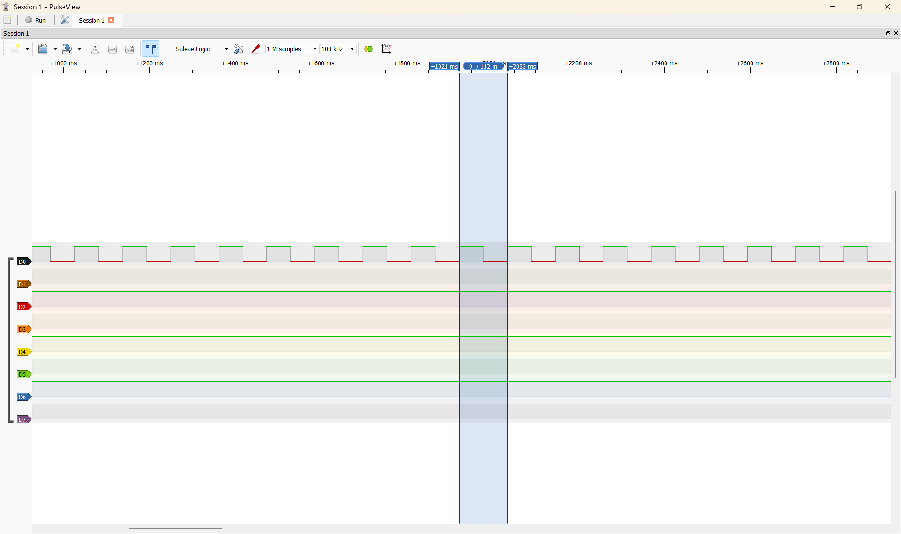

# Report — Week 1 / Ex1

`student_id`: 2413284   Commit của PREDICTION.md: 0h38 ngày 15/10/2026

## 1. Số đo
| Đại lượng | Giá trị |
|---|---|
| `BLINK_PERIOD_MS` (từ params.h) |113 ms|
| Chu kỳ đo được — min |112.0231 ms|
| Chu kỳ đo được — max |112.4498 ms|
| Chu kỳ đo được — trung bình |112.1655 ms|
| Sai số trung bình vs `BLINK_PERIOD_MS` |834.49 µs|
| `uxTaskGetStackHighWaterMark()` của bringup_task | 87 words |

Ảnh PulseView (>= 10 chu kỳ, đọc được giá trị): 

## 2. Ba handler của kernel
| Tên trong port ARM_CM3 | Tên trong vector table | Nhiệm vụ |
|---|---|---|
| `vPortSVCHandler` | SVC_Handler | Khôi phục context đã chuẩn bị trên stack để bắt đầu chạy task đầu tiên khi scheduler khởi động. |
| `xPortPendSVHandler` | PendSV_Handler | Lưu context task hiện tại và khôi phục context task được scheduler chọn, thực hiện chuyển task. |
| `xPortSysTickHandler` | SysTick_Handler | Cập nhật tick kernel, xử lý thời gian chờ và yêu cầu chuyển task qua PendSV khi cần. |

Log lỗi link trước khi sửa (dán nguyên văn):

```
D:/intern-261-rtos-course-easy/third_party/FreeRTOS-Kernel/portable/GCC/ARM_CM3/port.c:230: multiple definition of `SVC_Handler'; CMakeFiles/template.dir/Core/Src/stm32f1xx_it.c.obj:D:/intern-261-rtos-course-easy/template/Core/Src/stm32f1xx_it.c:146: first defined here
D:/intern-261-rtos-course-easy/third_party/FreeRTOS-Kernel/portable/GCC/ARM_CM3/port.c:459: multiple definition of `PendSV_Handler'; CMakeFiles/template.dir/Core/Src/stm32f1xx_it.c.obj:D:/intern-261-rtos-course-easy/template/Core/Src/stm32f1xx_it.c:172: first defined here
D:/intern-261-rtos-course-easy/third_party/FreeRTOS-Kernel/portable/GCC/ARM_CM3/port.c:492: multiple definition of `SysTick_Handler'; CMakeFiles/template.dir/Core/Src/stm32f1xx_it.c.obj:D:/intern-261-rtos-course-easy/template/Core/Src/stm32f1xx_it.c:185: first defined here
```

Cách sửa:
- B1: Bỏ chọn Generate IRQ handler cho SVC, PendSV và SysTick trong phần NVIC Code generation của CubeMX.
- B2: Generate lại code.
- B3: Build lại.

## 3. Tại sao HAL timebase phải sang TIM4
Phải trả lời được: `HAL_IncTick()` chạy ở đâu, `configKERNEL_INTERRUPT_PRIORITY`
ảnh hưởng gì đến nó, và `HAL_Delay()` / `vTaskDelay()` khác nhau chỗ nào.
**Trả lời:**
- HAL và FreeRTOS có hai bộ đếm thời gian phục vụ mục đích khác nhau:
    - Tick HAL phục vụ HAL_GetTick(), HAL_Delay() và các timeout của HAL.
    - Tick FreeRTOS phục vụ việc quản lý thời gian chờ của task, chẳng hạn vTaskDelay().

- Khi TIM4 phát ngắt:
→ TIM4_IRQHandler()
→ HAL_TIM_IRQHandler(&htim4)
→ HAL_TIM_PeriodElapsedCallback()
→ HAL_IncTick()

- Khi SysTick được giao cho FreeRTOS: SysTick phát ngắt
→ xPortSysTickHandler()
→ cập nhật tick kernel
→ đánh thức task đến hạn và yêu cầu chuyển task khi cần

- Do đó nếu thay handler SysTick bằng phần xử lý của kernel mà bỏ mất HAL_IncTick(), tick HAL sẽ ngừng tăng. Khi đó, các hàm chờ tick HAL có thể bị kẹt, dù tick FreeRTOS vẫn hoạt động.

- Về priority ngắt, STM32F103 có các mức từ 0 đến 15. Số càng nhỏ thì ngắt càng được ưu tiên cao; mức 15 là thấp nhất. Đây là quy tắc của NVIC, khác với priority task của FreeRTOS.
- Riêng port ARM_CM3 V11.3.1 đang dùng trực tiếp đặt SysTick và PendSV ở mức thấp nhất. Vì vậy, không thể chỉ đổi macro trên rồi cho rằng priority thực tế của hai ngắt chắc chắn đã thay đổi.
- Trong file cấu hình của em: configKERNEL_INTERRUPT_PRIORITY = 15 << 4 = 240. Vì STM32F103 chỉ sử dụng 4 bit cao.
- Nếu HAL_IncTick() cũng chạy trong SysTick, tick HAL sẽ phụ thuộc vào ngắt có ưu tiên thấp này. Ví dụ, một ISR có priority 10 gọi HAL_Delay() để chờ thời gian trôi qua. ISR đó có ưu tiên cao hơn SysTick ở mức 15, nên SysTick không thể ngắt nó để cập nhật tick. Kết quả là ISR chờ tick, còn tick lại phải chờ ISR kết thúc, khiến chương trình bị kẹt tại đó.
- Chuyển HAL timebase sang TIM4 giúp HAL có nguồn tick riêng và có thể cấu hình priority riêng. Tick HAL cũng không phụ thuộc vào việc thay đổi tick rate của FreeRTOS.

- Hai hàm delay khác nhau như sau:
| Hàm | Hoạt động |
|---|---|
| HAL_Delay(ms) |Chờ bằng cách liên tục kiểm tra tick HAL. Nếu gọi trong task, hàm không chủ động đưa task sang Blocked.|
| vTaskDelay(ticks) |Đưa task sang Blocked để chờ tick FreeRTOS. Trong lúc đó, CPU có thể chạy task khác, chẳng hạn Idle task.|


## 4. Lệch so với dự đoán
Với mỗi mục trong `PREDICTION.md` lệch so đo: lệch bao nhiêu, và **nguyên nhân vật lý**
(không được trả lời "do sai số").

**Trả lời:**
- Prediction: 112 ms
- Thực tế đo được: 112.1655 ms
→ Sai số là: 165,5 us
- Nguyên nhân có thể xác định được từ code là phép chia nguyên: 113 / 2 = 56 ms mà ở 1000 Hz: 56 ms → 56 tick nên hai khoảng chờ có tổng là 112 ms
- Ngoài ra còn có các yếu tố gồm độ trễ task được chạy lại sau khi đến hạn, xử lý ngắt, thời gian thực thi code.
- Vì em cấu hình sử dụng thạch anh ngoại nên clock thực tế có dung sai so với 72 MHz danh định.
- Logic analyzer có độ phân giải lấy mẫu hữu hạn nên có thể xung nhịp ở trên PulseView không chính xác hoàn toàn.
## 5. Câu hỏi đánh đổi
`configTICK_RATE_HZ` = 1000 trong bài này. Dựa vào số đo của **bạn**, nếu hạ xuống
100 Hz thì chu kỳ LED và sai số thay đổi thế nào? Trả lời bằng con số, không bằng lý thuyết.
**Trả lời:**
- Ở 1000 Hz, mỗi tick là 1 ms. Code hiện tại: 113 / 2 = 56 ms → pdMS_TO_TICKS(56) = 56 tick. Chu kỳ danh định là 112 ms; trung bình đã đo được là 112,1655 ms, sai lệch 834,49 us so với yêu cầu 113 ms.

- Nếu giữ nguyên code và giảm tick rate xuống 100 Hz, thì mỗi tick là 10 ms. Phép chuyển đổi mặc định làm tròn xuống: pdMS_TO_TICKS(113/2) = 56 × 100 / 1000 = 5 tick. Mà 5 tick = 50 ms nên chu kỳ đầy đủ danh định = 50 + 50 = 100 ms. Do đó, em dự đoán chu kỳ gần 100 ms, sai lệch so với yêu cầu là 13 ms.
- Khi so sánh với hiện tại, chu kỳ giảm từ 112 ms xuống 100 ms, tức ngắn thêm 12 ms. Sai lệch tăng đáng kể vì tick 10 ms không biểu diễn được khoảng chờ 56 ms.