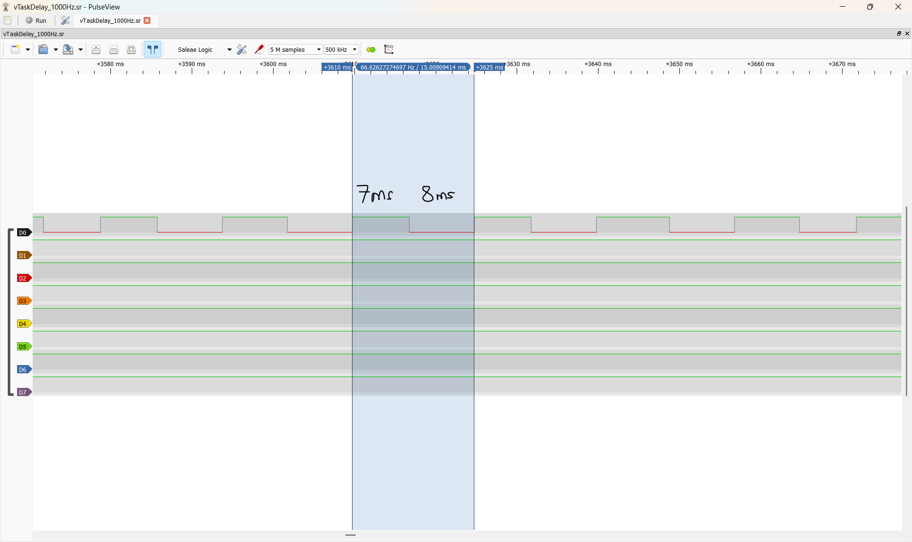
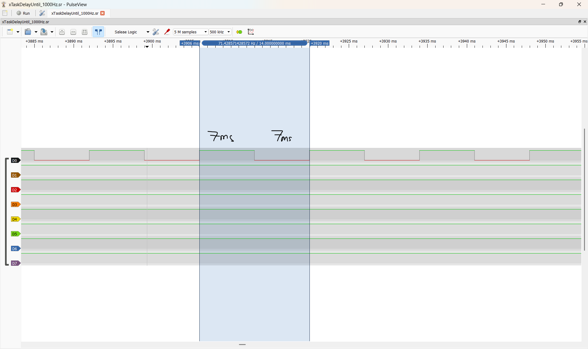

# Report — Week 1 / Ex3

`student_id`: 2413284   Commit của PREDICTION.md: 76a5d5e46c2233c2ea70fb37e267ebccdd3a4594

- Theo xác nhận của anh Triều, bài này chỉ khảo sát `vTaskDelay` và `xTaskDelayUntil` ở tick rate **1000 Hz**. 

## 1. Bảng thống kê (tính từ CSV, không đọc tay)
| # | Delay | Tick | min (ms) | max (ms) | tb (ms) | jitter = max−min (us) | drift tổng (ms) |
|---|---|---|---|---|---|---|---|
| 1 | `vTaskDelay` | 1000 | 6.999 | 9.002 | 7.728 | 2003 | 582.332 |
| 2 | `xTaskDelayUntil` | 1000 | 6.999 | 7.002 | 7.000 | 3.000 | 0.3 |
| 3 | `vTaskDelay` | 100 | | | | | |
| 4 | `xTaskDelayUntil` | 100 | | | | | |

- Script dùng để tính: analyze_csv.py
- CSV gốc:
    - [captures/vTaskDelay_1000Hz.csv](captures/vTaskDelay_1000Hz.csv) (có commit kèm)
    - [captures/xTaskDelayUntil_1000Hz.csv](captures/xTaskDelayUntil_1000Hz.csv) (có commit kèm)
- Ảnh:   
## 2. Tại sao `vTaskDelay` bị drift
Công thức drift theo `PERIOD_MS` và `WORK_JITTER_US` của **bạn**, rồi so với số đo:
- Công thức drift: Drift = SAMPLE_COUNT × (1000 + 2(WORK_JITTER_US - 2000 + 1))/(WORK_JITTER_US + 1)
- `vTaskDelay` lấy tick hiện tại tại lúc gọi cộng số tick cần chờ. Trong mô hình task bắt đầu gần đầu tick, bỏ qua chi phí phụ và interrupt, tải 0–999 us tạo khoảng lặp 7 ms; tải 1000–1999 us tạo khoảng 8 ms; tải 2000–2400 us tạo khoảng 9 ms.

| | Tính theo công thức | Đo được | Lệch |
|---|---|---|---|
| Drift tổng (ms) | +600.416 | +582.332 | -18.084 |

## 3. Tại sao tick 100 Hz sai nhiều hơn
`PERIOD_MS` = 7 ms ; một tick = 10 ms. Chứng minh bằng số đo, không bằng lý thuyết:
**Trả lời:**
- Theo xác nhận của anh Triều, bài này chỉ khảo sát `vTaskDelay` và `xTaskDelayUntil` ở tick rate **1000 Hz**. Nhưng em xin được dự đoán như sau: Với 7 ms ở tick rate là 100 Hz chuyển thành **0 tick**. `vTaskDelay(0)` yêu cầu lập lịch lại và không block chờ, còn `xTaskDelayUntil` với increment bằng 0 vi phạm assert. 

## 4. `xTaskDelayUntil` trả về gì
Giá trị trả về nghĩa là gì, và trong 4 lần chạy của bạn nó có bao giờ báo
"đã trễ deadline" không? Bao nhiêu lần / `SAMPLE_COUNT`?
**Trả lời:**
- xTaskDelayUntil() có trả về giá trị kiểu BaseType_t, từ giá trị này ta có thể kiểm tra task có bị trễ so với thời điểm dự đoán.
- `pdTRUE` nghĩa là task đã block để chờ mốc tiếp theo nên được đánh thức đúng lịch hoặc trước khi deadline bị bỏ lỡ.
- `pdFALSE` nghĩa là không block vì mốc cần chờ đã đến hoặc đã qua.
- Trong lần chạy debugger kiểm tra API riêng, sau khi cho chương trình chạy liên tục rồi Pause, em đọc được: checked_cycles = 800 và no_block_count = 0.

## 5. Lệch so với dự đoán
Mỗi dòng lệch trong bảng → lệch bao nhiêu + nguyên nhân vật lý.
**Trả lời:**
- Đại lượng | Prediction | Measured | Measured − prediction | Nguyên nhân vật lý |
|---|---:|---:|---:|
| Chu kỳ trung bình vTaskDelay (ms) | 7.75 | 7.727915 | -0.022085 | Vì ở prediction em giả định work_us có phân phối đều nên khi ramdom kết quả sẽ khác so với kết quả tính toán nên kết quả có sai lệch nhỏ |
| Jitter vTaskDelay (us) | 2000 | 2003 | +3 | Khá gần với dự đoán, nguyên nhân có thể từ độ phân giải lấy mẫu của Logic Analyzer, nhiễu thực tế |
| Drift vTaskDelay (ms) | 600 | 582.332 | -17.668 | Vì ở prediction em giả định work_us có phân phối đều nên khi ramdom kết quả sẽ khác so với kết quả tính toán nên kết quả có sai lệch nhỏ |
| Chu kỳ trung bình xTaskDelayUntil (ms) | 7 | 7.000375 | +0.000375 | Gần với dự đoán, xấp xỉ 0 |
| Jitter xTaskDelayUntil (us) | ~0 | 3 | ~3 | Lệnh cỡ vài us nên có thể đến độ phân giải lấy mẫu của Logic Analyzer |
| Drift xTaskDelayUntil (ms) | ~0 | +0.300 | ~0.300 | Sai lệch có thể đến từ clock danh định của MCU, nhiễu và độ phân giải lấy mẫu của logic analyzer |

## 6. Câu hỏi đánh đổi
Tick 1000 Hz cho độ chính xác tốt hơn nhưng **tốn** gì? Dựa vào dữ liệu của bạn:
đo CPU overhead của tick ISR ở 100 Hz và 1000 Hz (gợi ý: cho một task ưu tiên thấp
nhất đếm vòng lặp trong 1 giây, so sánh 2 cấu hình). Điền số:

| Tick rate | Số vòng lặp idle đếm được trong 1 s | Overhead suy ra (%) |
|---|---|---|
| 100 Hz | | |
| 1000 Hz | | |

Với ứng dụng `PERIOD_MS` = ____ của bạn, bạn chọn tick rate nào? Bảo vệ bằng số trên.
**Trả lời:**
- Theo phạm vi chỉ đo 1000 Hz, không có bảng overhead thực nghiệm so sánh 100/1000 Hz nên em không thể suy ra CPU overhead.

- Về lý thuyết, tick rate cao làm tăng số lần ngắt tick mỗi giây và chi phí xử lý liên quan (ngắt hệ thống,...). Với chu kỳ 7 ms, tick 1000 Hz biểu diễn được chu kỳ bằng 7 tick; tick 100 Hz thì biểu diễn chu kỳ sẽ được làm tròn xuống 0 tick. Với xTaskDelayUntil giữ chu kỳ trung bình 7.000375 ms và drift +0.300 ms, còn vTaskDelay có chu kỳ trung bình 7.727915 ms và drift +582.332 ms, cả 2 đều gần sát với chu kỳ yêu cầu 7 ms. Do đó em chấp nhận overhead CPU tăng để đáp ứng yêu cầu thời gian của ứng dụng. S
