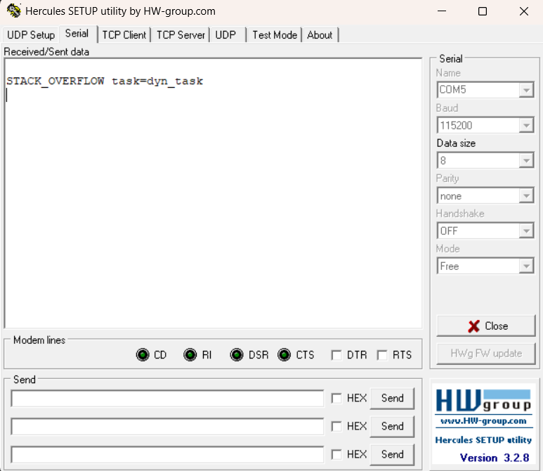
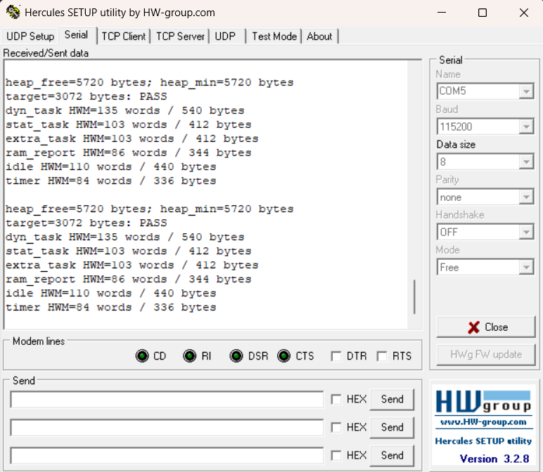

# Report — Week 1 / Ex4

`student_id`: 2413284   Commit của PREDICTION.md: 9763acf1a80199e9f7d0cadb29cc86e8dce2787e

## 1. Ngân sách RAM từ `.map`
| Mục | Symbol / section trong `.map` | Bytes |
|---|---|---|
| `.data` | .data: 0x60 | 96 |
| `.bss` (không kể heap) | .bss − ucHeap: 0x2AA8 − 0x2000 | 2728 |
| Heap FreeRTOS (`ucHeap`) | .bss.ucHeap: 0x2000 | 8192 |
| Stack của main (MSP) | _Min_Stack_Size: 0x400 | 1024 |
| Còn lại / chưa dùng | — | 8440 |
| **Tổng** | | **20480** |

`.map` commit tại: `4f1621d5c5c4b95fa38dc32ca6dc5a3b1684bfbe`

## 2. Số lúc chạy (dán nguyên văn log UART)
```
heap_free=6320 bytes; heap_min=6320 bytes
target=3072 bytes: PASS
dyn_task HWM=135 words / 540 bytes
stat_task HWM=103 words / 412 bytes
ram_report HWM=86 words / 344 bytes
idle HWM=109 words / 436 bytes
timer HWM=85 words / 340 bytes
```

| Đại lượng | Words | Bytes |
|---|---|---|
| `xPortGetFreeHeapSize()` | — | 6320 |
| `xPortGetMinimumEverFreeHeapSize()` | — | 6320 |
| HWM `dyn_task` | 135 | 540 |
| HWM `stat_task` | 103 |412 |
| HWM `ram_report_task` | 86 | 344 |
| HWM idle task | 109 | 436 |
| HWM timer task | 85 | 340 |

Heap còn trống >= `TARGET_FREE_HEAP_BYTES` (3072)? Có, dư 3248 bytes so với mục tiêu.

## 3. Đối chiếu `.map` vs runtime
Heap trong `.map` = 8192 bytes ; `xPortGetFreeHeapSize()` = 6320 bytes ; lệch = 1872 bytes.
Lệch này gồm những gì (liệt kê từng mục kèm số bytes):
- Stack của dyn_task: 160 word = 640 bytes
- Stack của ram_report_task: 256 words = 1024 bytes
- TCB của hai task: 152 bytes
- Header của bốn khối cấp phát: 32 bytes
- Padding của hai khối TCB: 8 bytes
- Căn chỉnh và end marker: 16 bytes

## 4. Dynamic vs static
HWM của `dyn_task` và `stat_task` lệch 32 words dù làm cùng một việc. Vì sao?
`xTaskCreate` và `xTaskCreateStatic` khác nhau ở đâu về **nơi** TCB và stack nằm?
**Trả lời:**
| Task | Stack được cấp (words) | HWM (words) | Stack đã dùng (words) |
|---|---|---|---|
| dyn_task | 160 | 135 | 25 |
| stat_task | 128  | 103 | 25 |

- HWM khác nhau vì kích thước stack ban đầu khác nhau và chênh lệch 160 − 128 = 32 words, đúng bằng chênh lệch HWM 135 − 103 = 32 words.
- Về nơi lưu TCB và stack:
    - xTaskCreate(): FreeRTOS cấp phát TCB và stack lúc chạy từ heap FreeRTOS. Trong cấu hình này, nó nằm bên trong ucHeap, việc tạo task làm giảm xPortGetFreeHeapSize().
    - xTaskCreateStatic(): ứng dụng cung cấp sẵn stat_tcb và stat_stack. Hai biến có vùng lưu trữ tĩnh, nằm trong .bss ngoài ucHeap. Việc tạo task không cấp phát thêm TCB/stack từ heap FreeRTOS.
## 5. Tràn stack
Log/ảnh chứng minh hook đã chạy:



Tại sao trong `vApplicationStackOverflowHook` không được gọi hàm UART blocking
(hoặc: nếu bạn vẫn gọi được, giải thích tại sao nó không crash — và tại sao đó là may):
- Vì hook được gọi từ scheduler trong PendSV và dùng MSP; task bình thường dùng PSP. Vì vậy hook không tiếp tục dùng chính stack task đang bị phát hiện lỗi. Tuy nhiên, overflow vẫn có thể đã làm hỏng dữ liệu khác.

- HAL_UART_Transmit() dùng polling: CPU chờ cờ TXE/TC rồi ghi dữ liệu vào UART, không cần ngắt truyền UART để hoàn tất, may là task bị tràn chưa ghi đè vào vùng nhớ phục vụ cho UART nên vẫn log UART được.

## 6. Stack nhỏ nhất an toàn
| Lần thử | Stack (words) | HWM (words) | Kết quả |
|---|---|---|---|
| 1 | 160 | 5 | Chạy được nhưng chưa thỏa điều kiện biên 32 words |
| 2 | 152 | — | Hook báo STACK_OVERFLOW task=dyn_task |
| 3 | 188 | 33 | ĐẠT ĐIỀU KIỆN BIÊN 32 WORDS |
| 4 | 187 | 33 | ĐẠT ĐIỀU KIỆN BIÊN 32 WORDS |
| 5 | 186 | 31 | Chạy được nhưng chưa thỏa điều kiện biên 32 words |

Giá trị cuối cùng chọn: 187 words. Biên an toàn: 33 words. Lý do chọn biên đó: Mức 186 words chỉ còn 31 words, nên không đạt tiêu chí dù task vẫn chạy. Mức 188 words cũng đạt nhưng lớn hơn mức cần chọn. Vì vậy, 187 words là mức nhỏ nhất đạt tiêu chí.

## 7. Lệch so với dự đoán
Mỗi dòng lệch + nguyên nhân.
| Mục | Dự đoán (bytes) | Thực tế (bytes) | Độ lệch (bytes) | Nguyên nhân |
|---|---:|---:|---:|---|
| `.data` | 128 | 96 | −32 | Dự đoán 128 bytes chưa được tính từ từng symbol cụ thể. File .map thực tế còn có các bytes biến khởi tạo của hệ thống, thư viện C, FreeRTOS Và bytes padding. |
| `.bss` không kể heap FreeRTOS | 2560 | 2728 | +168 | Ước lượng ban đầu của em chưa tính đủ các biến tĩnh và padding. |
| Heap FreeRTOS (`ucHeap`) | 8192 | 8192 | 0 | Cấu hình đúng `HEAP_SIZE_BYTES = 8192`. |
| Stack của main (MSP) | 1024 | 1024 | 0 | Linker đặt `_Min_Stack_Size = 0x400`, đúng dự đoán. |
| Còn lại / chưa dùng | 8576 | 8440 | −136 | `.data` và `.bss` cộng lại tăng `168 − 32 = 136` bytes. |

## 8. Câu hỏi đánh đổi
Với `HEAP_SIZE_BYTES` = 8192 của bạn: nếu phải thêm một task nữa có stack 128 words,
**lấy RAM từ đâu**? Dựa vào bảng ngân sách của bạn, đưa ra 2 phương án kèm chi phí
cụ thể (bytes), rồi chọn một và **thực hiện, đo lại để chứng minh**.
**Trả lời:**
| Phương án | Nguồn RAM | Chi phí |
|---|---|---:|
| `xTaskCreate()` | Heap FreeRTOS còn trống | Stack `512 + 8` và TCB `76 + 8 + 4` = **608 bytes** |
| `xTaskCreateStatic()` | Vùng SRAM còn lại, khai báo buffer trong `.bss` | Stack 512 + TCB 76 = **588 bytes** |

- Chọn phương án tạo bằng `xTaskCreate()`: vì hiện tại còn 6320 bytes heap trống, đủ để thêm task và vẫn đáp ứng mục tiêu 3072 bytes. 

- Vì Heap trống giảm 6320 − 5720 = 600 bytes. Trong khi đó chi phí cấp phát task mới vẫn là 608 bytes; chênh lệch 8 bytes được giải thích bằng việc căn chỉnh heap: 
    - Theo cấu hình ucHeap đang tại 0x2000099C, hao hụt khởi tạo 16 bytes. 
    - Sau khi thêm handle: ucHeap tại 0x200009A0, hao hụt khởi tạo còn 8 bytes.
-> Do đó: 6320 − 608 + 8 = 5720 bytes, khớp số đo.