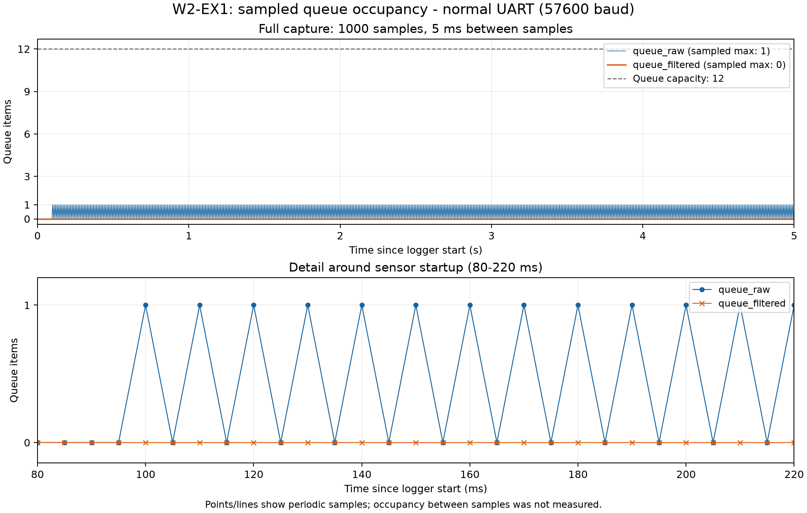
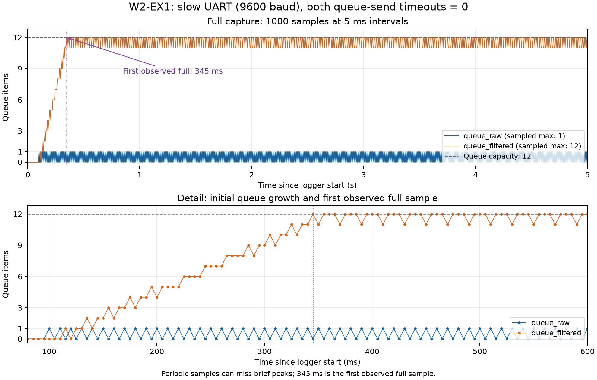

# Report — Week 2 / Ex1

`student_id`: 2413284   Commit của PREDICTION.md: 43de4e9b3c78b84f727b98a4f875019269ade674

## 1. Kích thước queue tối thiểu
| | Dự đoán | Đo được | Khớp? |
|---|---|---|---|
| `queue_raw` | 1 | Dao động quanh 0 và 1 | Khớp với dự đoán |
| `queue_filtered` | 1 | 0 | Không khớp với dự đoán|

Nếu lệch: nguyên nhân (thời gian xử lý thực tế khác ước lượng, jitter I2C, ...).
**Trả lời:**
- Thông qua debug, filter_output_dropped = 0 và UART liên tục gửi sequence. Tuy nhiên mẫu phải được gửi qua `queue_filtered` trước khi UART nhận, do đó nguyên nhân sai lệch có thể là do logger bỏ lỡ khoảng queue chứa một phần tử giữa hai lần đọc. 

## 2. Đồ thị độ đầy queue theo thời gian
Cấu hình bình thường: 

**Giải thích:**
- `Queue_raw` không tăng dần mà chỉ quan sát ở mức 0 hoặc 1 vì filter nhận và xử lý kịp. `Queue_filtered` có thể chỉ giữ mẫu trong khoảng ngắn vì filter gửi, rồi block chờ `queue_raw`, sau đó UART được chạy và lấy mẫu trước lần đọc logger tiếp theo. Ngoài ra khi debug sensor_i2c_errors, sensor_raw_dropped, filter_output_dropped, uart_format_errors và uart_tx_errors đều bằng 0, chu kỳ logger 5 ms và sensor 10 ms, nên có thể UART đã lấy mẫu trước khi logger kịp đọc nên `queue_filtered` quan sát được bằng 0.

Cấu hình UART chậm (9600 baud): 

**Giải thích:**
- `Queue_filtered` tăng đến 12 rồi dao động ở 11–12, còn `queue_raw` vẫn ở 0–1. Vì UART gửi dữ liệu chậm hơn tốc độ lấy dữ liệu của sensor (ở 9600 baud, dòng khoảng 19–20 byte cần khoảng 20 ms truyền dây, trong khi đó đầu vào đến mỗi sau 10 ms). Khi `queue_filtered` đầy, filter gửi timeout 0 thất bại rồi tiếp tục nhận dữ liệu mới `queue_raw`, nên điểm làm mất mẫu nằm tại đầu ra của filter thay vì làm `queue_raw` tích tụ.

## 3. Khi nào queue đầy
Mô tả **chính xác** thời điểm `queue_filtered` bắt đầu đầy khi hạ baud, và số
mẫu bị mất/trễ (đếm bằng số thứ tự mẫu gắn trong payload).
**Trả lời:**
- 
- Ở UART 9600 baud, timeout gửi bằng 0, logger lần đầu ghi nhận `queue_filtered` đầy 12 phần tử tại **345 ms** tính từ lúc logger bắt đầu. Khi debug ta xem được, tổng số mẫu bị bỏ là 237 tại filter, sensor không bỏ mẫu. 

## 4. Hành vi 3 kiểu timeout
| Timeout | Kết quả quan sát khi queue đầy |
|---|---|
| 0 | Trả thất bại ngay, filter bỏ 237 mẫu; raw chỉ lên tối đa 1 phần tử. |
| giá trị hữu hạn: 5 ms | Chờ chỗ trống tối đa 5 tick, nếu vẫn đầy thì bỏ mẫu. Filter bỏ 240 mẫu, sensor không bỏ mẫu. |
| `portMAX_DELAY` | Filter Blocked chờ chỗ trống, không bỏ mẫu tại filter. `Queue_raw` đầy 12 phần tử, sensor bỏ 227 mẫu vì vẫn gửi timeout 0. |

- Theo cấu hình đo ở UART 9600 baud, chỉ đổi timeout gửi của **filter** và sensor luôn gửi timeout 0.

## 5. Lệch so với dự đoán
Mỗi mục lệch + nguyên nhân vật lý.
**Trả lời:**
- `Queue_filtered` dự đoán dao động 0 → 1 → 0, nhưng logger chỉ quan sát thấy 0 ở 57600 baud. Vì mẫu được UART nhận giữa hai lần đọc logger cách nhau 5 ms nên có thể bỏ lỡ mức 1.
- **Ước lượng UART khoảng 6 ms, trace ghi nhận raw-ready → UART truyền xong khoảng 4 ms:** dự đoán dùng dòng tối đa 33 byte nhưng dòng thực tế ngắn hơn.
- **Filter dự đoán khoảng 0,1 ms:** Vì mỗi mẫu chỉ cần cập nhật running sum và tính trung bình ba trục nên dự đoán thời gian khá nhỏ. Tuy nhiên khi lưu thời điểm raw-data sẵn sàng và filter tính xong lại dùng bộ đếm chỉ tăng mỗi 1 ms. Do đó hai sự kiện nằm trong cùng một tick sẽ có hiệu bằng 0 tick dù vẫn cách nhau một khoảng thời gian. Vì vậy nguyên nhân là do độ phân giải chưa đủ để đo.

## 6. Câu hỏi đánh đổi
Với `SAMPLE_PERIOD_MS` của **bạn**, nếu `FILTER_WINDOW` tăng gấp đôi thì độ trễ
từ cảm biến đến UART tăng thêm bao nhiêu ms? Trả lời bằng số từ dữ liệu của bạn,
rồi đo lại để kiểm chứng.
**Trả lời:**
- Xét độ trễ của từng mẫu, từ lúc đọc xong cảm biến đến lúc UART truyền xong kết quả cùng `seq`:

    - Độ trễ = thời điểm UART truyền xong − thời điểm đọc cảm biến xong

Với `SAMPLE_PERIOD_MS = 10 ms`, dự kiến tăng cửa sổ từ 16 lên 32 không làm tăng đáng kể độ trễ này: filter dùng running sum, cập nhật và xuất kết quả sau mỗi mẫu, không chờ đủ một cửa sổ mới gửi nen số phép tính mỗi lượt gần như không đổi.
- Kiểm chứng:

| FILTER_WINDOW | Độ trễ từng mẫu đo được |
|---|---|
| 16 | Khoảng 4 ms |
| 32 | Khoảng 4 ms |

- Kết luận: Hai cửa sổ đều đo được khoảng 4 ms, chưa ghi nhận độ trễ tăng ở độ phân giải 1 ms.
- Đánh đổi: Đánh đổi khi tăng cửa sổ lên gấp đôi là đầu ra được làm mượt hơn nhưng phản ánh biến động chậm hơn, dù thời gian xử lý và truyền từng mẫu gần như giữ nguyên. 
