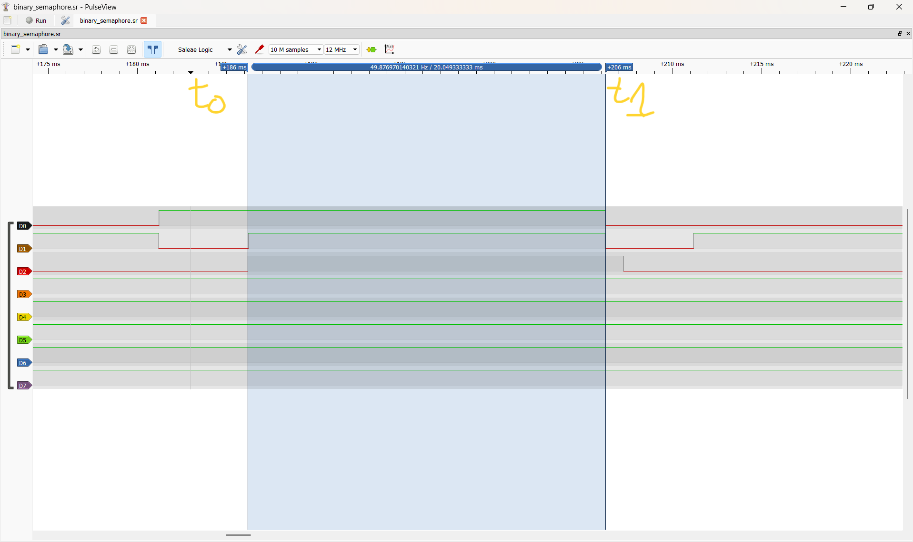
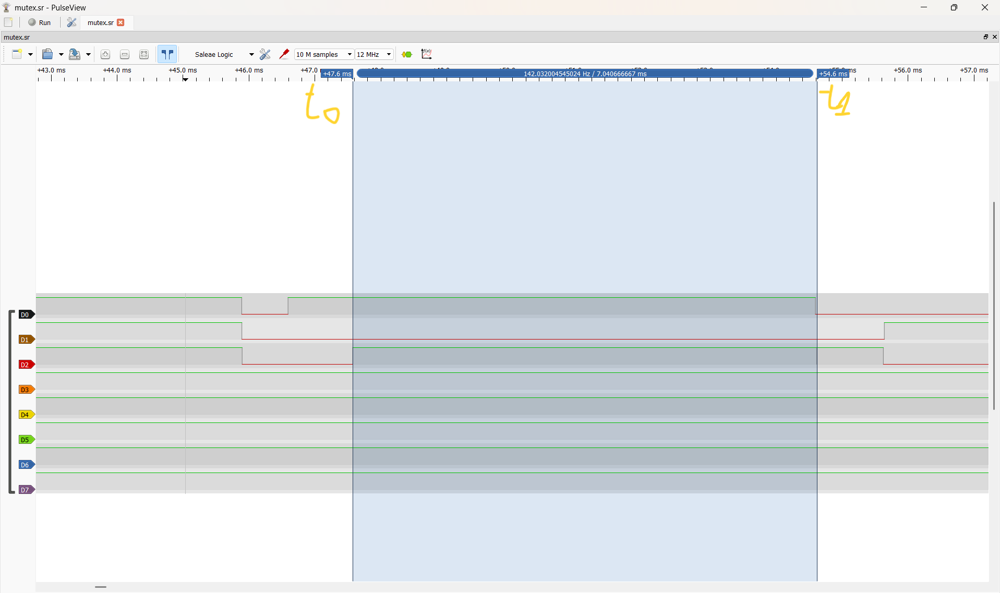
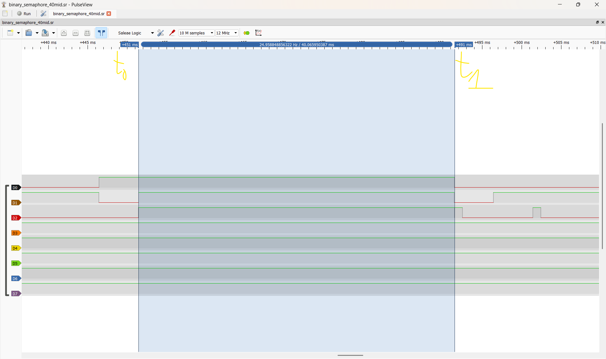

# Report — Week 2 / Ex3

`student_id`: 2413284    Commit của PREDICTION.md: 89b9933d47a7b4ffa33ccecc007513bc703a7dbb

## 1. Ảnh đo
Binary semaphore: 
Mutex: 

Trên mỗi ảnh, đánh dấu: thời điểm `task_high` sẵn sàng chạy (t0), thời điểm nó
thực sự chạy (t1). Thời gian block = t1 − t0.

## 2. Bảng thời gian block
| Cấu hình | t0 (us) | t1 (us) | Block (us) | Đạt `DEADLINE_MS`? |
|---|---|---|---|---|
| Binary semaphore | 186188 | 206237 | 20049 | ĐẠT |
| Mutex | 47574 | 54615 | 7041 | ĐẠT |

## 3. Vì sao mutex ngắn hơn
Giải thích bằng priority inheritance: `task_low` được nâng lên ưu tiên nào, khi
nào, và việc đó ngăn `task_mid` chen vào như thế nào.

- Ở cấu hình mutex, task_high gọi take nhưng mutex đang do task_low giữ nên task_high bị block. Kernel áp dụng **priority inheritance**, tạm nâng priority hiệu lực của task_low từ **1 lên 3**, bằng priority của task_high. lúc này task_low có priority 3 cao hơn task_mid = 2 nên được chạy tiếp trước task_mid để hoàn thành công việc và give mutex, khi give mutex xong priority của task_low được đặt lại về 1.

## 4. task_mid trong lúc inversion
Mô tả trạng thái kênh `task_mid` trên ảnh binary semaphore trong khoảng
inversion — chạy bao nhiêu lần, mỗi lần bao lâu.
- Trong khoảng inversion, task_mid thực hiện **một đợt công việc khoảng 20 ms** trong lúc task_high bị chặn. D1 giữ mức cao trong đợt này, phù hợp với `MID_WORK_MS = 20`.

## 5. Lệch so với dự đoán
Mỗi mục lệch + nguyên nhân vật lý.

| Cấu hình | Dự đoán(ms) | Đo được(ms) | Lệch(ms) | Nguyên nhân |
|---|---|---|---|---|
| Binary semaphore | 20 | 20.049 | 0,049 ms  | Dự đoán lý tưởng chỉ tính đợt công việc 20 ms của task_mid. Thực tế CPU còn phải thực thi take/block, chuyển task, kiểm tra DWT, give và các lệnh GPIO |
| Mutex | 8 | 7.041 | 0,959 ms | Vì chưa tính khoảng thời gian của task_high có lệnh `vTaskDelay(1U)` để khởi động, với tick 1 ms. Trong khoảng task_high chờ tick để trở thành Ready thì task_low đã chạy trước |

## 6. Câu hỏi đánh đổi
Với bộ tham số của **bạn**, nếu `MID_WORK_MS` tăng gấp đôi thì thời gian block ở
cấu hình binary semaphore tăng thêm bao nhiêu? Trả lời bằng số từ dữ liệu của
bạn, rồi đo lại để kiểm chứng. `task_high` còn đạt `DEADLINE_MS` không?

- Dự đoán: nếu `MID_WORK_MS` tăng gấp đôi thì thời gian block ở cấu hình binary semaphore sẽ tăng thêm tương ứng là 20 ms. Do đó 20.049 + 20 = 40.049 > `DEADLINE_MS` nên `task_high` không đạt `DEADLINE_MS` 

- Kiểm chứng: 

- t0 = 451 ms; t1 = 491 ms nên task_high block = t1 - t0 = 40 ms, tăng đúng so với dự đoán. Vậy `task_high` không đạt `DEADLINE_MS`.