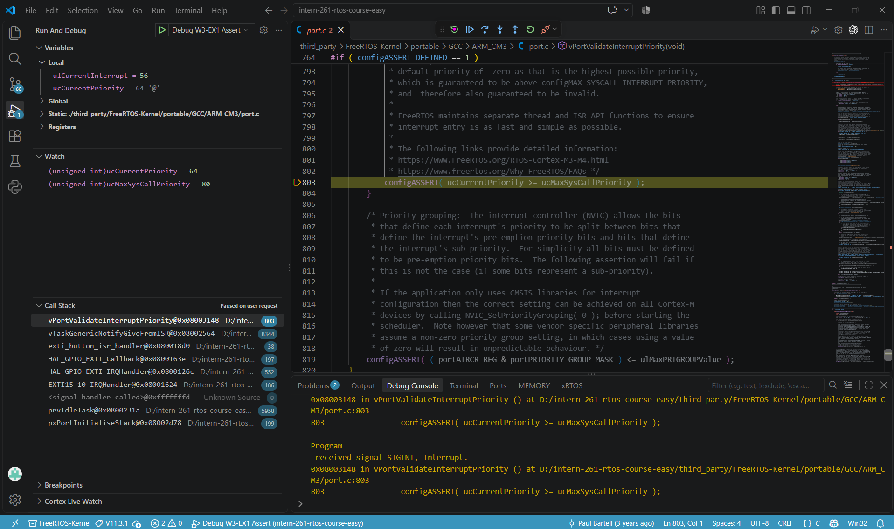
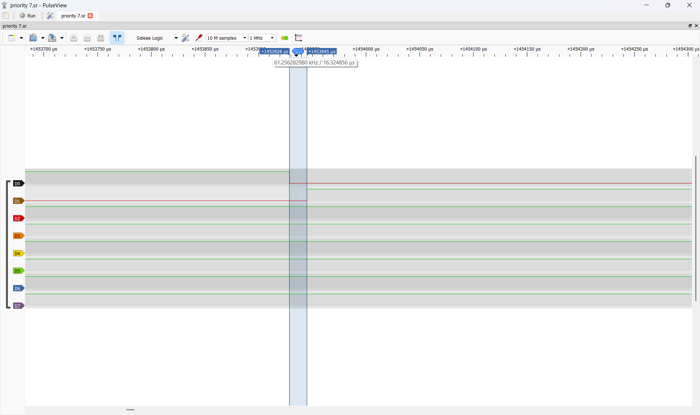
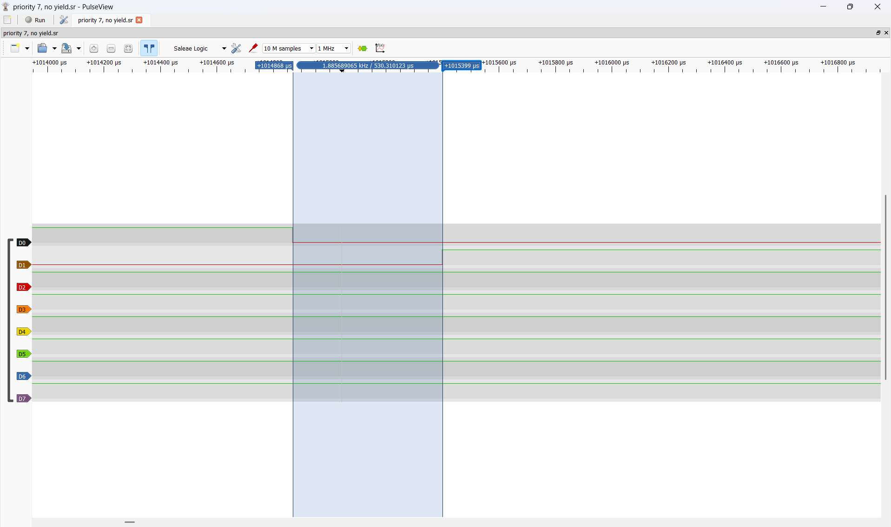
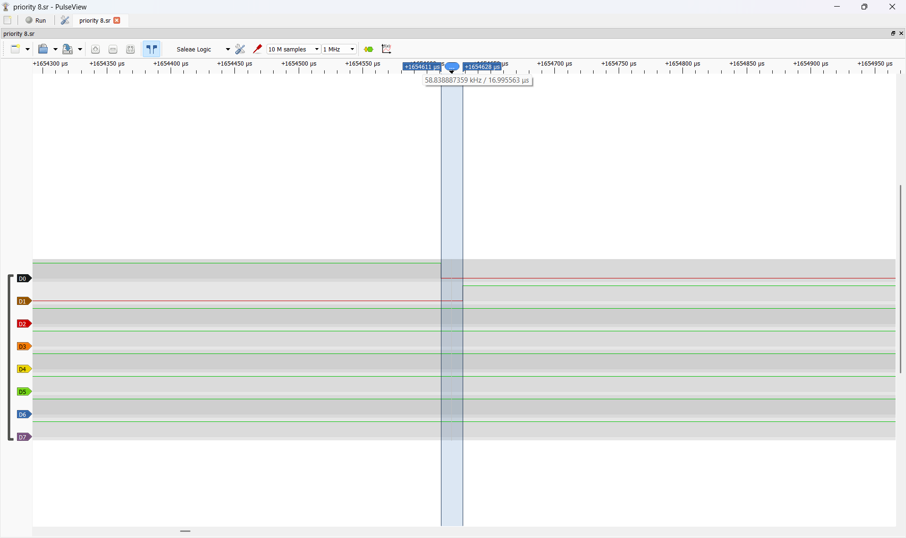

# Report — Week 3 / Ex1

`student_id`: 2413284  Commit của PREDICTION.md: 469f7160227cde650ce4ac55316392ebf874dbbf

## 1. Bằng chứng configASSERT
Mô tả/log/ảnh lúc priority sai (bước 4 README) + giải thích chính xác **vì sao**
assert được kích hoạt (nêu đúng tên macro và điều kiện).
**Trả lời:** 

- Khi đặt EXTI priority bằng 4. Sau khi ack_task đã vào trạng thái chờ notification, nút PB10 được nhấn. Debugger cho thấy IRQ EXTI gọi exti_button_isr_handler(), sau đó đi qua vTaskGenericNotifyGiveFromISR() đến vPortValidateInterruptPriority().

- Điều kiện kiểm tra trong port Cortex-M3 là configASSERT(ucCurrentPriority >= ucMaxSysCallPriority). Hai giá trị quan sát trong Watch là ucCurrentPriority = 64 = 0x40 và ucMaxSysCallPriority = 80 = 0x50. Vì 0x40 < 0x50, điều kiện sai nên CPU đi vào vòng lặp vô hạn của configASSERT.

## 2. Latency ISR → task
| Cấu hình | Dự đoán (us) | Đo được (us) | Đạt `LATENCY_BUDGET_US`? |
|---|---|---|---|
| Có `portYIELD_FROM_ISR` | 9,27 | 16,32 | Đạt |
| Không có `portYIELD_FROM_ISR` | 0 - 1000 (lấy trung bình 500) | 530,31 | Không đạt |

Ảnh logic analyzer đính kèm cho cả 2 cấu hình.

- Có `portYIELD_FROM_ISR`:  
- Không có `portYIELD_FROM_ISR`:  

## 3. Giải thích quan hệ priority
Giải thích bằng lời của bạn: số NVIC priority nhỏ/lớn nghĩa là gì, vì sao
`configLIBRARY_MAX_SYSCALL_INTERRUPT_PRIORITY` tồn tại, điều gì xảy ra nếu một
ISR ưu tiên cao hơn ngưỡng này gọi API FreeRTOS.
**Trả lời:** 
- Trong NVIC, số càng nhỏ thì ngắt có ưu tiên phần cứng càng cao. Cấu hình dùng 4 bit priority. Với NVIC_PRIORITYGROUP_4, cả 4 bit dùng cho preemption priority. HAL nhận giá trị chưa dịch bit, còn FreeRTOS so sánh giá trị đã dịch trái 4 bit. Ví dụ, priority 7 được mã hóa thành 0x70.

- configLIBRARY_MAX_SYSCALL_INTERRUPT_PRIORITY = 5 đặt giới hạn cho ISR gọi API FromISR. Giá trị tương ứng trong thanh ghi là configMAX_SYSCALL_INTERRUPT_PRIORITY = 0x50. Khi bảo vệ dữ liệu kernel, FreeRTOS dùng BASEPRI để chặn các ngắt có số priority từ 5 đến 15. Ngắt có số priority nhỏ hơn 5 vẫn có thể chen vào khi kernel đang cập nhật dữ liệu dùng chung. Gọi API FreeRTOS từ một ISR ở mức đó vi phạm điều kiện của port và có thể làm hỏng trạng thái kernel.

- Priority cá nhân 7 hợp lệ vì 5 ≤ 7 ≤ 15. Với cấu hình sai 4, kiểm tra trong port bắt được lỗi trước khi notification được gửi.

- Task ack_task dùng task priority 2, cao hơn Idle priority 0. Khi IRQ xảy ra trong lúc Idle chạy và ack_task đang Blocked, notification đưa ack_task sang Ready. Nếu có portYIELD_FROM_ISR, PendSV được yêu cầu để scheduler chọn ack_task ngay sau đường thoát ISR.

## 4. Lệch so với dự đoán
Mỗi mục lệch + nguyên nhân vật lý (jitter NVIC, pipeline, v.v.).
**Trả lời:** 
- Có portYIELD_FROM_ISR: Dự đoán 9,27 us, thực tế 16,32 us nên lệch 7,05 us. Vì Prediction dùng số chu kỳ ước lượng cho từng đoạn. Sai lệch có thể đến từ số lệnh do compiler sinh, chi phí gọi hàm HAL, truy cập bộ nhớ và quá trình lưu, khôi phục context. Phép đo từ PB10 đến PA8 cho biết độ trễ tổng, nên em chưa tách được chi phí thực tế của từng đoạn.

- Không có portYIELD_FROM_ISR: Dự đoán tăng trung bình 500 us, thực tế thì 530,31 do đó lệch 530,31 − 16,32 = 513,99 µs. Vì khi bỏ yield, ack_task đã Ready sau notification và thường chờ đến tick FreeRTOS tiếp theo để được chạy. Với tick 1.000 Hz, khoảng chờ thêm dự đoán phụ thuộc thời điểm nhấn nút và nằm từ gần 0 đến gần 1.000 µs. Giá trị 500 µs là mốc trung bình ước lượng nếu thời điểm nhấn phân bố đều trong chu kỳ tick.

## 5. Câu hỏi đánh đổi
Nếu tăng `ISR_NVIC_PRIO` của bạn lên một bậc (ưu tiên thấp hơn) trong khi vẫn
hợp lệ, latency đo được thay đổi bao nhiêu? Trả lời bằng số đo thật, không
đoán.
**Trả lời:** 
- Nếu tăng NVIC priority của EXTI từ 7 lên 8. Cả hai mức đều nằm trong khoảng hợp lệ từ 5 đến 15. Em dự đoán latency đo được cũng xấp xỉ 16-17 us. Vì đường đi từ EXTI qua notification và PendSV đến ack_task giống nhau ở hai cấu hình.
- Kiểm chứng:  

- Kết luận: Đo được xấp xỉ 17 us lệch 0,68 µs (17,00 − 16,32). Sai số khá nhỏ chấp nhận được có thể nguyên nhân từ việc tần số lấy mẫu của Logic Analyzer.
