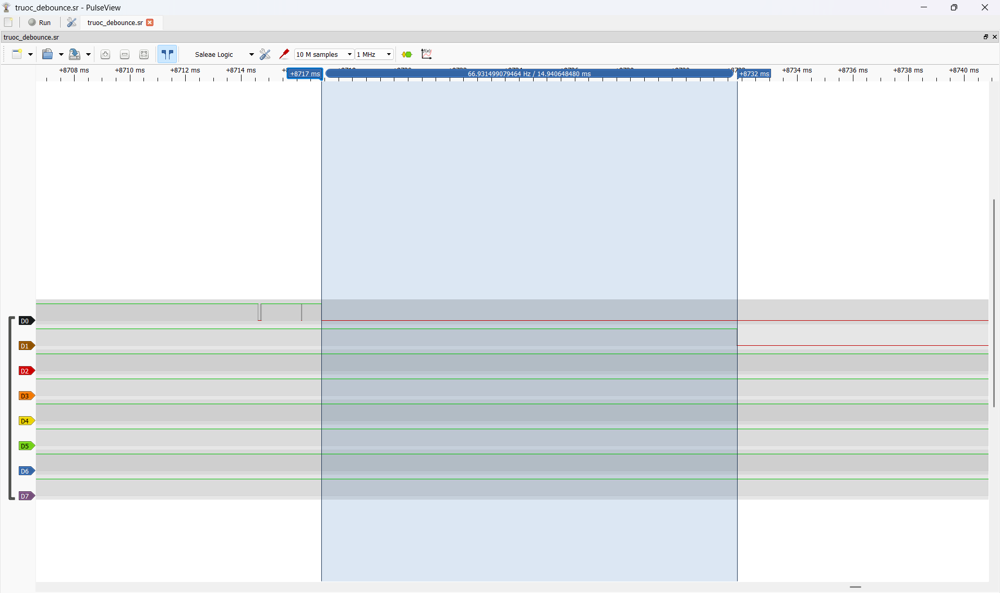
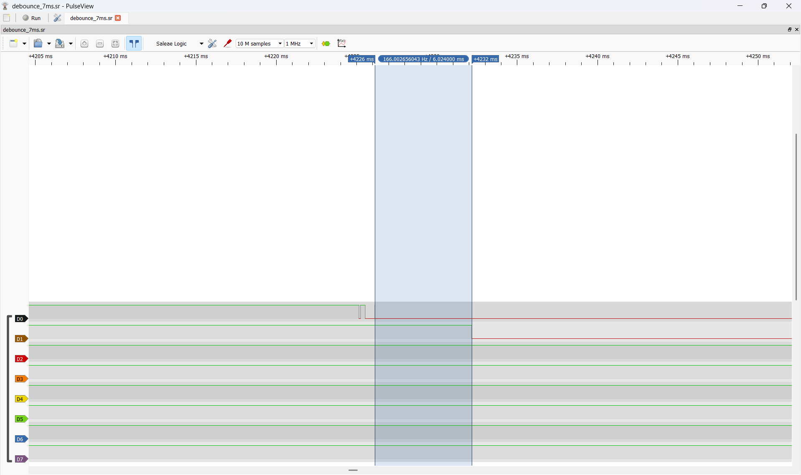

# Report — Week 3 / Ex2

`student_id`: 2413284   Commit của PREDICTION.md: d269f59936ce67c1850f95d4b0e9ec3a7250be32

## 1. Nảy phím trước/sau
Ảnh logic analyzer: tín hiệu thô (nhiều cạnh nảy) và tín hiệu "PRESS" sau khi
qua `debounce_timer` (một cạnh sạch).

 

## 2. Callback bị block — thí nghiệm bước 4
| | Dự đoán | Đo được |
|---|---|---|
| Độ trễ `longpress_callback` khi `debounce_callback` block 50ms | tối đa 50 ms, nhấn giữ bình thường thì 0 ms | 0 ms |

Log timestamp (`xTaskGetTickCount()`) của cả hai callback quanh lúc bị block.

- Log khi chưa block 50ms:

```
PRESS 420
HELD 1005
```
- Log khi thêm block 50ms:
```
BLOCK_BEGIN 40692
PRESS 40742
HELD 41277
```

- Giải thích: Lấy thời điểm vào debounce callback trừ 15 ms để suy ra mốc thời gian của cạnh nhấn cuối. Khi chưa block thì là 420 − 15 = 405, nên HELD dự kiến ở 405 + 600 = 1005, khớp với log. Khi có block 50ms là 40692 − 15 = 40677, nên HELD dự kiến ở 40677 + 600 = 41277, cũng khớp log.

## 3. Giải thích daemon task
Giải thích **bằng cơ chế**, không chỉ hiện tượng: vì sao một callback block sẽ
ảnh hưởng timer khác, liên hệ đến timer command queue và việc có đúng MỘT
daemon task xử lý tất cả software timer.
**Trả lời:**
- Trong FreeRTOS, tất cả software timer dùng chung một timer daemon task. Các lệnh điều khiển như START, STOP và RESET được gửi vào timer command queue. Daemon xử lý các lệnh này, theo dõi thời điểm hết hạn và gọi từng callback. Các hàm Callback chạy trong chính daemon task. Vì vậy, nếu một callback gọi hàm gây block, làm cả daemon phải chờ. Trong thời gian đó, các lệnh mới vẫn nằm trong queue và những timer đến hạn chưa được gọi callback. Do đó callback của software timer phải ngắn và tránh block để không ảnh hưởng đến timer khác.

## 4. Long-press
Thời gian giữ thực tế đo được so với `LONGPRESS_MS`: khớp không?
**Trả lời:**
- Thời gian thực tế có khớp so với `LONGPRESS_MS`,
- Trong LONGPRESS.log ghi PRESS 12339 và HELD 12924. Trên logic analyzer, lần nhấn giữ nút khoảng 871,935 ms. UART bắt đầu phát HELD sau 600,117 ms tính từ cạnh nhấn. PRESS được xác nhận sau cửa sổ debounce 15 ms, nên mốc của cạnh nhấn cuối được suy ra là 12339 − 15 = 12324. Từ mốc đó đến HELD đầu tiên là 12924 − 12324 = 600 ms, tương ứng với `LONGPRESS_MS` = 600 ms

## 5. Lệch so với dự đoán
Mỗi mục lệch + nguyên nhân.
**Trả lời:**
| Phép đo | Sai lệch và nguyên nhân |
|---|---|
| Debounce 15 ms | Đo được 14,941 ms, lệch khoảng 0,059 ms. Sai lệch này phù hợp với độ phân giải tick 1 ms của FreeRTOS, vì cạnh GPIO có thể xảy ra giữa hai tick. |
| Long-press 600 ms | Đo được 600,117 ms, lệch so với dự đoán 0,117 ms. Vì khoảng đo chịu ảnh hưởng của thời điểm tick, lập lịch daemon và thời gian từ callback đến lúc task UART bắt đầu truyền. |
| Callback block 50 ms | Đo được 50 tick block và 0 tick trễ thêm của HELD, khớp với dự đoán cho lần nhấn giữ bình thường. Daemon đã hết block trước khi HELD đến hạn. |

## 6. Câu hỏi đánh đổi
Với `DEBOUNCE_MS` của bạn, nếu giảm xuống còn một nửa thì tín hiệu sau debounce
còn sạch không? Đo lại trên board của bạn, không suy luận suông.
**Trả lời:**
- Nếu giảm `DEBOUNCE_MS` xuống một nửa là 15 ms / 2 =  7 ms thì tín hiệu sau debounce vẫn sạch.

- Kiểm chứng:

 

- Kết luận: Khi nhả nút, PB10 (D0) có 5 cạnh nảy trong 0,989 ms. PA8 (D1) chỉ có một cạnh xuống, khoảng 6,03 ms sau cạnh nảy cuối.