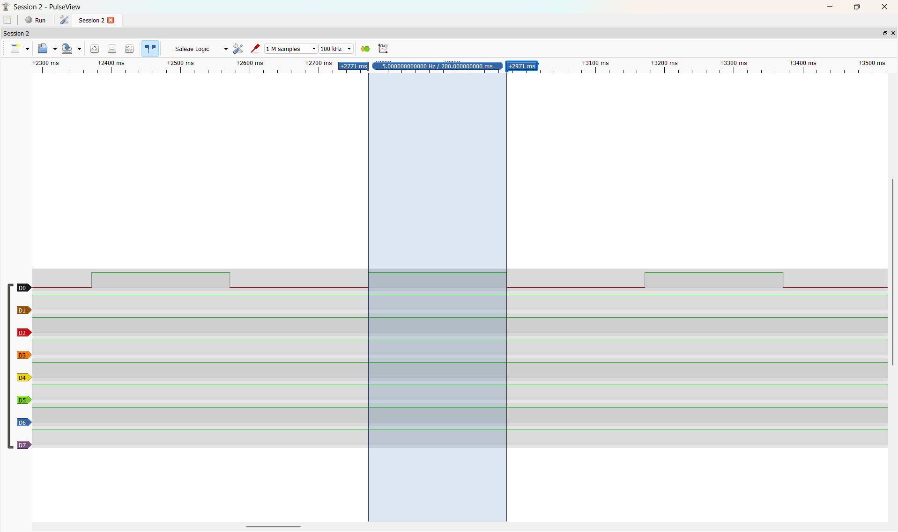
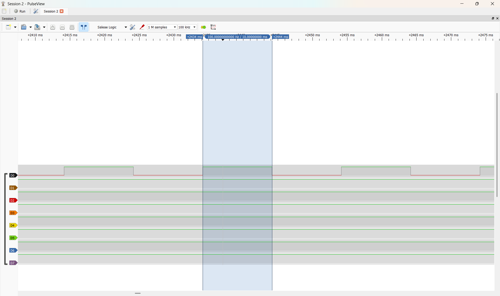
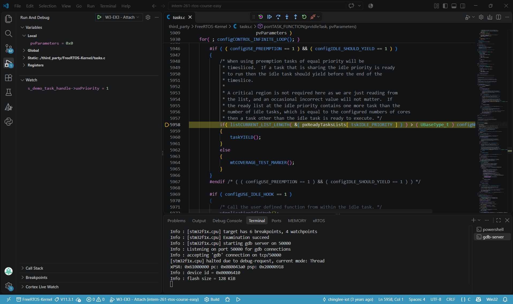
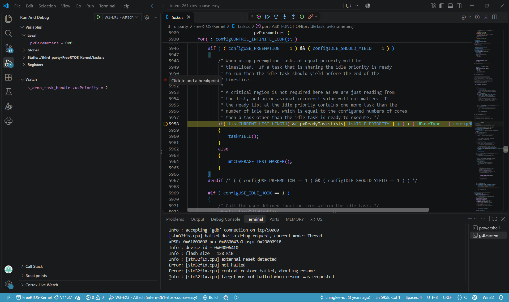
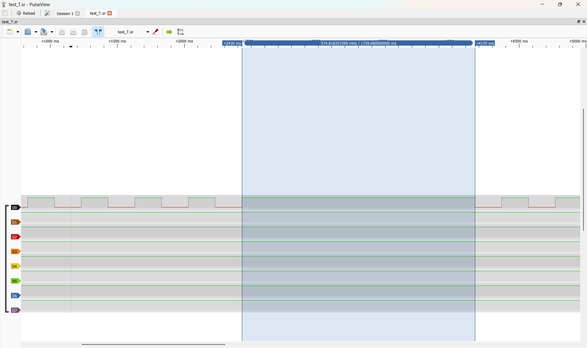
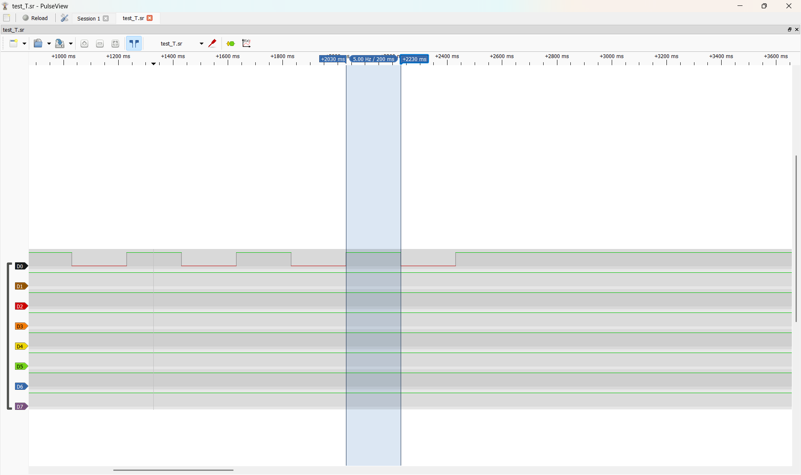
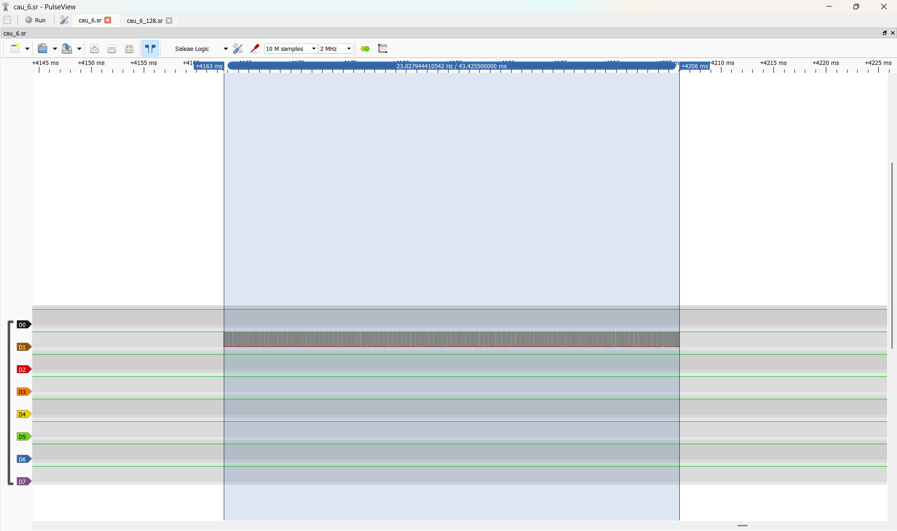
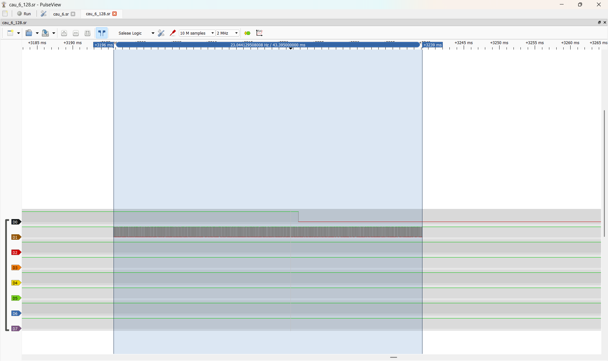

# Report — Week 3 / Ex3

`student_id`: 2413284    Commit của PREDICTION.md: 8820a79c7d2cbec340493355cfaab20cd0e28b6f

## 1. Thời gian byte & độ sâu stream buffer
Phép tính thời gian 1 byte ở `RX_BAUD`, và số lệnh tối đa chứa được trong
`STREAM_BUFFER_BYTES`.
**Trả lời:**

-  UART chạy ở `115200 baud`, cấu hình 8N1. Mỗi byte chiếm 10 bit trên đường truyền, gồm 1 start bit, 8 data bit và 1 stop bit. Thời gian truyền một byte là `10 / 115200 ≈ 86,81 µs`.
- Đặt `parser_task` ở priority 3, cao hơn priority khởi đầu 1 của demo, để khi được đánh thức parser có thể chạy sớm và rút dữ liệu đang đến cách nhau khoảng 86,81 µs/byte
- `MAX_CMD_LEN` = 24 nên một lệnh dài tối đa 24 byte, gồm 23 byte nội dung và 1 byte `\r`. Khi parser chưa đọc dữ liệu, stream buffer 64 byte chứa được **2 lệnh đầy đủ**, chiếm 48 byte. 16 byte còn lại chứa được một phần lệnh tiếp theo.

## 2. Demo 3 loại lệnh
Bằng chứng (log/ảnh) `demo_task` phản ứng đúng với `P`, `S`, `T` — mỗi loại ít
nhất 1 ví dụ có số liệu trước/sau.
**Trả lời:**
- Trước P10\r:
     
    
- Sau P10\r:
     

- Trước S2\r:
    

- Sau S2\r:
     

- T0\r: 
    

- T1\r:
     

## 3. Test gửi nhanh
| | Số lệnh gửi | Số lệnh nhận đúng | Mất/lỗi |
|---|---|---|---|
| Gõ tay bình thường | 5 | 5 | 0 |
| Gửi liên tục (script) | 100 | 100 | 0 |

Nếu có mất byte: giải thích bằng cơ chế (stream buffer đầy, parser bị trễ,
hay nguyên nhân khác) — không chỉ nói "bị mất".

## 4. Vì sao stream buffer, không phải queue
Giải thích bằng lời của bạn.
**Trả lời:**
- UART nhận dữ liệu từng byte. Ví dụ, với P10\r, ISR lần lượt nhận P, 1, 0 và `\r`. Dùng stream buffer để giữ các byte theo đúng thứ tự, còn `parser_task` sẽ lấy từng byte và dùng `\r` để xác định ranh giới lệnh. Mô hình này có đúng một bên ghi là ISR USART1 và một bên đọc là parser, phù hợp với cách dùng stream buffer của FreeRTOS.

- Queue có phần tử kích thước cố định. Nếu đặt kích thước phần tử là 1 byte, queue vẫn truyền được cùng luồng dữ liệu và `parser_task` vẫn có thể ghép lệnh. Sự khác biệt nằm ở cách đánh thức task đang chờ. Với queue từng byte, byte đầu tiên có thể đánh thức parser đang chờ trên queue rỗng. Với stream buffer, đề bài đặt trigger 16 byte, nên khi dữ liệu đến liên tục, các byte có thể tích lại trước khi đánh thức parser. Với lệnh ngắn như P10\r chỉ có 4 byte, ISR chủ động báo cho `parser_task` sau khi ghi thành công \r để lệnh được xử lý ngay.

- Vì vậy, stream buffer phù hợp hơn với luồng UART có một bên ghi và một bên đọc, đồng thời cho phép gom byte khi dữ liệu đến liên tục và xử lý ngay khi đã có đủ một lệnh.

## 5. Lệch so với dự đoán
Mỗi mục lệch + nguyên nhân.
**Trả lời:**
| | Sai lệch và nguyên nhân |
|---|---|
| Gõ tay bình thường | Khớp với dự đoán. Gõ tay nhận đúng 5/5 lệnh |
| Gửi liên tục (script) | Khớp với dự đoán. Script nhận đúng 100/100 lệnh theo thứ tự, với s_rx_dropped_bytes = 0. Parser đã theo kịp lượt gửi. |

## 6. Câu hỏi đánh đổi
Với `RX_BAUD` của bạn, nếu tăng gấp đôi `STREAM_BUFFER_BYTES`, tốc độ gửi tối
đa không mất byte tăng thêm bao nhiêu (đo thật, không suy luận)?
**Trả lời:**
- Dự đoán: Ở 115200 baud, em dự đoán tăng stream buffer từ 64 lên 128 byte sẽ giúp chứa thêm dữ liệu khi parser bị trễ. Nếu bản 64 byte đã nhận kịp ở tốc độ tối đa của đường truyền thì tăng buffer sẽ không làm tăng tốc độ gửi không mất byte.

- Tốc độ gửi trước khi tăng gấp đôi `STREAM_BUFFER_BYTES`:
        
        
- Tốc độ gửi sau khi tăng gấp đôi `STREAM_BUFFER_BYTES`:
        

