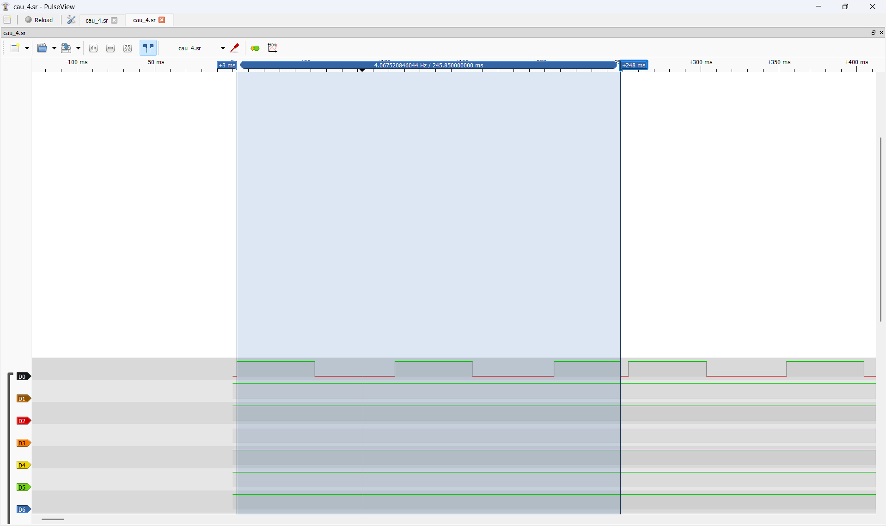

# Report — Week 3 / Ex4

`student_id`: 2413284   Commit của PREDICTION.md: 0121c8fb67c61e7207c2d0f1c1878150990de0fd

## 1. Bảng CPU %
| Task | CPU % (lần đo 1) | CPU % (lần đo 2) |
|---|---|---|
| IDLE  | 82% | 82% |
| load  | 9% | 9% |
| stats | 7% | 7% |
| beta  | <1% | <1% |
| alpha | <1% | <1% |
| hb    | <1% | <1% |
| sup   | <1% | <1% |
| **Tổng** | **~100%** | **~100%** |

Giải thích Idle task chiếm bao nhiêu % và vì sao.
- **Idle ≈ 82%**. Vì Idle có priority 0, chỉ chạy khi không có task nào Ready.
- Mỗi lần chuyển task, kernel cộng `CYCCNT − CYCCNT_lúc_vào` cho task vừa chạy. Task đang nằm trong
  `vTaskDelay` / `xEventGroupWaitBits` bị gỡ khỏi danh sách Ready, nên không được cộng thời gian.
- Các task khác chỉ dùng khoảng 18% CPU, cụ thể:
    - load: 9%
    - stats in UART kiểu polling 7%
    - alpha/beta/hb/supervisor khoảng 2%


## 2. Bằng chứng tìm deadlock
Log/ảnh `uxTaskGetSystemState` **trước khi sửa**: trạng thái từng task, chỉ
rõ `task_alpha`/`task_beta` đang `eBlocked` và đang chờ mutex nào. Giải thích
chính xác thứ tự lấy mutex nào gây ra deadlock (AB-BA).
**Trả lời:**
```
==== t=1058 ms ====
stats          	4395075		5%
IDLE           	71920832		94%
Tmr Svc        	1972		<1%
alpha          	3789		<1%
beta           	4040		<1%
stats state=0 rt=5361661
IDLE state=1 rt=71920832
Tmr Svc state=2 rt=1972
alpha state=2 rt=3789
beta state=2 rt=4040
A held by alpha, B held by beta
==== t=1588 ms ====
stats          	6574271		5%
IDLE           	107901635		94%
Tmr Svc        	1972		<1%
alpha          	3789		<1%
beta           	4040		<1%
stats state=0 rt=7547112
IDLE state=1 rt=107901635
Tmr Svc state=2 rt=1972
alpha state=2 rt=3789
beta state=2 rt=4040
A held by alpha, B held by beta
```
- `task_alpha` và `task_beta` đều **eBlocked**. `rt` đứng yên ở 3789 và 4040 cycle nên chúng bị block vĩnh viễn, không phải đang trong `vTaskDelay`.
- `s_mutex_a` do alpha giữ, `s_mutex_b` do beta giữ. Alpha giữ A mà vẫn bị block, nên alpha chờ
  **`s_mutex_b`**. Beta giữ B, nên beta chờ **`s_mutex_a`**.
- **Nguyên nhân AB-BA:**
  - alpha: `Take(A)` → `vTaskDelay(5)` → `Take(B)`
  - beta: `Take(B)` → `vTaskDelay(5)` → `Take(A)`
  - Trong 5 ms alpha ngủ với A trong tay, beta lấy được B. Khi cả hai tỉnh dậy, mỗi task chờ khóa mà task kia
  đang giữ với `portMAX_DELAY`, tạo thành vòng chờ khép kín.

## 3. Sửa lỗi
Mô tả thay đổi bạn làm để hết deadlock (thứ tự lấy mutex thống nhất). Xác
nhận chạy ổn định sau khi sửa (thời gian chạy thử).
**Trả lời:**
- `task_beta` đổi sang lấy **A trước rồi B**, giống `task_alpha` và ngược lại sẽ nhả theo thứ tự B rồi A. Khi mọi task lấy
  khóa theo cùng một thứ tự, task đến sau bị chặn ngay ở A, lúc nó chưa giữ khóa nào, nên không thể có deadlock.
```
==== t=528 ms ====
stats          	2205067		5%
IDLE           	35738197		93%
beta           	125391		<1%
alpha          	88589		<1%
Tmr Svc        	1972		<1%
stats state=0 rt=3188955
IDLE state=1 rt=35738197
alpha state=2 rt=91145
beta state=2 rt=131349
Tmr Svc state=2 rt=1972
A held by beta, B held by none

==== t=1058 ms ====
stats          	4403459		5%
IDLE           	71485163		93%
alpha          	178654		<1%
beta           	256480		<1%
Tmr Svc        	1972		<1%
stats state=0 rt=5395018
IDLE state=1 rt=71485163
alpha state=2 rt=178654
beta state=2 rt=256480
Tmr Svc state=2 rt=1972
A held by none, B held by none
```
- Chạy liên tục **78 s** thì `rt` của alpha và beta tăng đều qua mỗi chu kỳ, dòng mutex chủ yếu là `none`, không còn giữ chéo. 

## 4. Watchdog
Phép tính reload IWDG. Log/video board tự reset khi deadlock được tái tạo lại
có chủ đích, kèm thời gian từ lúc treo đến lúc reset — so với`IWDG_TIMEOUT_MS`.
**Trả lời:**
- reload = IWDG_TIMEOUT_MS × (LSI_HZ / prescaler) / 1000 = 250 × 10000 / 1000 = 2500   (≤ 4095)

```
stats state=0 rt=1598568
IDLE state=1 rt=0
load state=2 rt=289482
hb state=2 rt=1526
sup state=2 rt=1280
Tmr Svc state=2 rt=2222
alpha state=2 rt=3786
beta state=2 rt=3768
A held by alpha, B held by beta
WDT MISS t=100 bits=0x0c
WDT MISS t=202 bits=0x0c

*** BOOT: reset by IWDG ***
```
- Thời gian từ lúc treo - reset:



## 5. Lệch so với dự đoán
Mỗi mục lệch + nguyên nhân.
**Trả lời:**
| Mục | Dự đoán | Thực tế | Chênh lệch | Nguyên nhân |
|---|---|---|---|---|
| Thời điểm treo | sau vài chu kỳ | **ngay chu kỳ đầu**, t ≈ 5 ms (rt alpha = 3789 cycle ≈ 53 µs) | — | Hai task cùng priority, cùng bắt đầu ở t = 0; `vTaskDelay(5)` giữa 2 lần lấy khóa luôn cho task kia đủ thời gian lấy khóa thứ hai|
| State khi treo | alpha, beta Blocked còn Idle Ready | Khớp với dự đoán | — | — |
| Giá trị reload | 2500 | thanh ghi RL = **2499** | 0 | Vì giá trị reload tính được là số giá trị cần phải đếm nên thanh ghi RL = 2499 khớp với việc đếm từ 0 - 2499 đủ 2500 giá trị |
| Thời gian reset | ≈ 250 ms sau lần refresh cuối | IWDG ≈ **246 ms**| 4 ms (1,6%) | Có thể do sai lệch từ LSI |

## 6. Câu hỏi đánh đổi
Với `SUPERVISOR_BITS` và chu kỳ check-in của bạn, nếu một task thật sự chạy
chậm (không deadlock, chỉ chậm) trong đúng 1 chu kỳ, supervisor có false-trip
(reset oan) không? Trả lời bằng số đo thời gian thực tế của chu kỳ check-in.
**Trả lời:**
- supervisor sẽ không false-trip (reset oan). 
- Vì nếu hết 100 ms timeout của supervisor mà chưa đủ bit thì sẽ **không** gây reset; supervisor chỉ bỏ qua một lần refresh. Bit đã set không bị xóa khi hết thời gian chờ, nên ngay khi task chậm check-in, lần chờ kế tiếp sẽ đủ bit và refresh luôn.
- Board chỉ reset khi không có refresh trong khoảng 246 ms (Từ mục 4)
```
==== t=1102 ms ====
stats          	6651027		8%
IDLE           	64999223		81%
alpha          	182921		<1%
beta           	193769		<1%
load           	7379340		9%
hb             	50229		<1%
sup            	36216		<1%
Tmr Svc        	2234		<1%
stats state=0 rt=8190382
IDLE state=1 rt=64999223
alpha state=2 rt=187033
beta state=2 rt=197881
load state=2 rt=7524843
hb state=2 rt=50229
sup state=2 rt=36216
Tmr Svc state=2 rt=2234
A held by none, B held by none
max refresh gap=51 ms
```
- Kết luận: khoảng cách lớn nhất giữa 2 lần supervisor nhận đủ 4 bit và refresh IWDG là **51 ms**, bằng chu kỳ của task chậm nhất (hb, 50 ms). Mà đo được IWDG chỉ reset khi không được refresh trong khoảng **246 ms** (đo ở mục 4). Vậy còn dư 246 − 51 ≈ **195 ms**: task chậm thêm dưới khoảng 195 ms thì không bị reset oan.